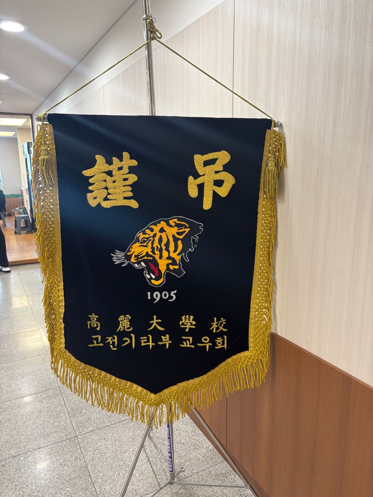
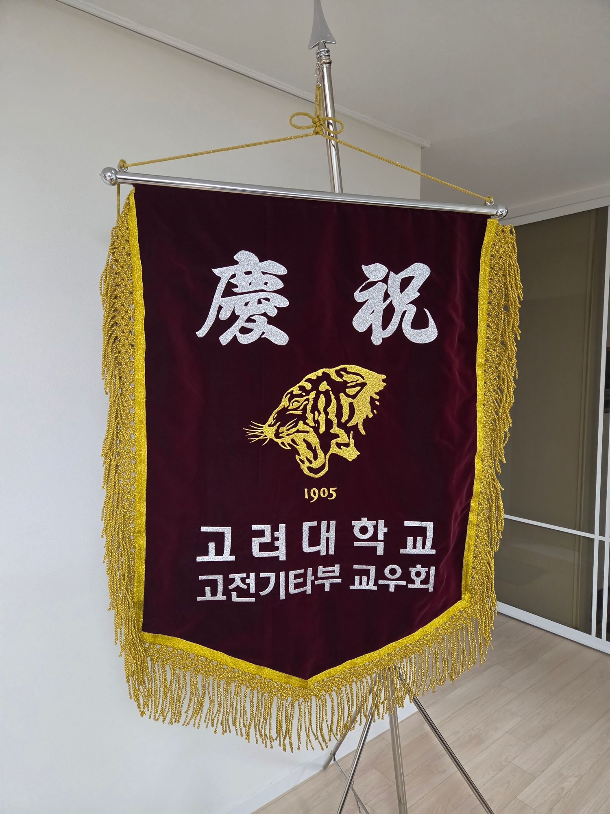

고기부 교우회에 경조사 발생 시 근조기/경하기 신청 절차에 대해 알려드립니다.

## 1. 근조기/경하기

- 현재 근조기/경하기가 1기씩 있습니다.

{: width="48%"} 

{: width="48%"}

## 2. 대상

- 고려대 고전기타부 재학생 및 졸업생 전체를 대상으로 합니다.
- 교우회비 납부 여부와 상관없이 지원합니다.

## 3. 절차

- 조사 (발생 즉시)
  - 조사의 경우 주로 지인분들이 밴드/게시판 등에 조사 소식을 올리게 됩니다.
  - 게시판에 조사 소식이 올라온 것을 회장단이 인지한 경우 댓글등으로 표시할 예정입니다.
  - 만약 게시판에 소식을 올리지 못하였거나 다른 경우 [카카오톡채널](http://pf.kakao.com/_xabxkSX)의 채팅창으로 조사를 신청해주시기 바랍니다.
  - 조사 소식을 받으면 근조기는 즉시 발송 요청 예정입니다.
  - 또한 SMS로 해당 조사를 근처 교우회원들에게 전달해 드립니다. 당사자 위/아래 대략 10기수 정도가 포함되도록 SMS를 보낼 예정입니다.
- 경사 (발생 7일 이전)
  - 경사는 일반적으로 미리 계획된 경우가 많습니다.
  - 경사의 경우 경하기가 필요한 경우 [카카오톡채널](http://pf.kakao.com/_xabxkSX)의 채팅창으로 부탁드립니다.
  - 7일 정도 이전에 신청 바랍니다. 
  - 행사 당일 경하기를 발송할 예정입니다.
  - 마찬가지로 SMS로 해당 경사를 근처 교우회원들에게 전달해 드립니다. 당사자 위/아래 대략 10기수 정도가 포함되도록 SMS를 보낼 예정입니다.

